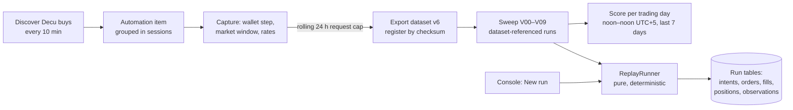

# Architecture review — 2026-11-12

A whole-project review of trenching-bot: architecture, findings ranked by impact, the diagnosis and fix of the failing dataset
runs, a prioritized roadmap and a Kotlin-versus-Go recommendation.

**How this was done.** 24 area audits (every backend module, the console frontend, and cross-cutting sweeps for security,
concurrency, numerics, the HTTP contract, complexity, product goals, delivery status, tests and a live UI walkthrough), then
adversarial re-checks of the serious claims by independent verifiers who were told to refute them. The run failures were
reproduced on a copy of the real local database. Where this document says **verified**, the behaviour was reproduced, measured
on the real data, or read end to end in the code. **Likely** means one link was inferred. **Assumption** marks anything not
checked. Raw area reports (about 600 KB) stay outside the repository.

**Update 2026-11-13.** Since this review, `develop` has gained:
- the fix from section 3;
- roadmap item 6: the backend suite passes on Windows, 2,079 tests with none failing;
- roadmap item 7: the first run on the bundled sample works;
- the backend half of item 3: unexpected failures answer `INTERNAL_ERROR` with an `errorId`, and the local profile writes a
  rolling log file;
- a mock backend that answers errors the way the backend does;
- LF line endings pinned in `.gitattributes`;
- a Prettier check in CI.

The console does not show the `errorId` yet. Everything else below is as found on 2026-11-12.

**The short version.**

1. The failing runs are fixed (section 3). The cause was not in the run code. The long-lived local database still enforced
   enum CHECK constraints from engine `dip-paper-v4`, and `ddl-auto: update` never revisits them.
2. That bug is one instance of a bigger pattern: the research data has no schema evolution path, no backup, and lives next to
   commands that delete it (F4).
3. The product's core loop runs, but it does not yet produce evidence. The sweep has stored 139 runs with **zero entries**.
   The $10k market-cap floor that every sweep variant keeps refused 12 of the 14 captured buys, and the other two never dipped.
   Capture demand is also about five times the provider request cap, so no trading day ever completes (F2, F3).
4. The console API is reachable without authentication from the LAN and through the public tunnel. Its local-only guard can be
   bypassed with an encoded path (verified with a test) (F5).
5. Stay on Kotlin. Nothing observed is language-related, and a port would cost 12–21 person-weeks to re-create bit-exact
   determinism (section 5).

---

## 1. Architecture and features

### What the product does

A read-only research system for one developer. It watches one Solana wallet ("Decu") for Pump.fun bonding-curve buys,
captures the on-chain market around each buy through a JSON-RPC provider (Helius free tier), and turns each capture into a
canonical replay dataset. It then replays a dip-entry paper-trading strategy against the recorded trades with bonding-curve
execution modelling, sweeps ten strategy configurations per buy, and scores them per trading day. It never signs or sends a
transaction.

### Runtime

| Piece | What it is |
|---|---|
| Backend | One Spring Boot 4.1 process (Kotlin 2.3, Java 21) on port 8081, profile `local` by default |
| Database | PostgreSQL 17 in Docker Compose on 5433; Hibernate `ddl-auto: update` in `local`/`test`, `validate` in `prod` (since amended 2026-11-16: prod runs `update`, see CLAUDE.md); no migrations |
| Capture store | JSON files under `build/captures` (sessions, operations, manifests, exported datasets, a shared transaction cache — 1.8 GB today) |
| Providers | Solana JSON-RPC (read-only, 8 allowed methods, 4 in flight, one start every 125 ms, rolling 24 h cap of 20,000 requests locally); Binance SOL/USDT |
| Console | React 19 + Vite + Mantine + ECharts + TanStack Query under `frontend/`; Vite dev server on 5173 proxies `/api`; a production build can be bundled into the backend under `/console`; `serve:public` exposes a preview through a jprq/ngrok tunnel |
| Automation | Six `@Scheduled` ticks on one scheduler thread; capture operations on a separate single-thread executor |

### Modules (main code)

| Module | Lines | Responsibility |
|---|---:|---|
| `chaincapture` | 1,625 | Read-only RPC transport: method allowlist, request/byte/deadline budgets, shared limiter, artifact store, verified transaction cache |
| `protocol/pumpfun` | 467 | Instruction and event layouts, bonding-curve math in `BigInteger` |
| `walletactivity` | 3,384 | Wallet history capture, token-account first buy, actual-first-buy verification, decode, normalizer |
| `marketdata` | 2,879 | Market windows `[buy − 50, buy + 4,500 slots]` (about 16 minutes), manifests v2–v5, reference rates, observations |
| `strategy` | 712 | `SimulationConfig` (`mvp()`, `agreed()`), dip-entry strategy, trade intents |
| `papertrading` | 422 | Fill model on the curve: impact, fees, transaction cost |
| `portfolio` | 601 | Positions and exits (take profit, stop loss, time, wallet sold), realized P&L |
| `replay` | 4,952 | Dataset schema v3–v6, catalog, deterministic runner (engine `dip-paper-v6`), persisted idempotent runs, CLIs |
| `apiusage` | 751 | Provider request accounting in 5-minute buckets |
| `console` | 14,447 | REST API (67 endpoints, 13 controllers), automation (6,550), capture console (2,234), Solana probe, mappers |
| `common`, `config` | 496 | Shared value types, application configuration, the new local schema repair |
| `notification`, `telegram` | 0 | Empty or planned |

Tests: 257 files, 38,856 lines, about 2,060 tests (24 Testcontainers integration classes). Frontend: about 32,300 production
lines, of which 18,130 are feature pages, 4,756 shared components and 4,744 an MSW mock backend; about 9,900 lines of tests
(68 files, 553 tests).

### Core flows

1. **Capture** (console or automation): a wallet + token session proves the wallet's first buy of the mint, records the market
   window around it (one `getTransaction` per trade, about 1.05–1.2 requests per recorded observation), records SOL/USDT rates,
   and exports a canonical dataset that the catalog registers by checksum.
2. **Run**: `POST /api/runs` validates the configuration, `ReplayRunner` replays the dataset (normalize wallet events, dip-entry
   strategy, curve fills, exits), and one transaction stores the run and its seven result tables. The run id is
   `sha256(engine version, dataset hash, configuration hash)`, so a repeated request is idempotent.
3. **Automation**: discovery queues qualifying buys, the pipeline captures them oldest first under the request cap, the sweep
   stores ten dataset-referenced runs per buy (`decu-sweep-1`), and day scoring issues `SUCCESS`, `NO_SUCCESS` or
   `NO_RESULT` over the last seven trading days. Backfills extend history into the past.
4. **Console**: dashboard, datasets, runs (new, detail, compare), captures, automation (overview, day, backfills), API usage
   and a Solana probe.

**How the frontend and backend fit.** All 67 backend endpoints have a UI caller, and every UI call has an endpoint. Decimals
travel as strings, enum codes are typed or humanized, and the error envelope (`code`, `message`, `fields`, `suggestion`,
`retryAfterSeconds`) is parsed carefully. The contract itself is hand-maintained on both sides: about 1,600 lines of TypeScript
DTO mirrors and a 4,700-line MSW mock backend that re-implements backend rules. There is no OpenAPI document and no contract
test, and the mock has already drifted (F11).

### Feature status

| Status | Features |
|---|---|
| Delivered | Read-only capture with budgets and pacing; wallet + token first-buy proof; market windows with resume; datasets v3–v6; deterministic replay with curve execution; persisted idempotent runs; dataset upload, sample import, charts, run detail and compare; agreed-strategy preset; API usage accounting; automation discovery, sessions, capture, sweep, day scoring, backfills, item and day retry |
| Partial | Local-only access guard; error envelope (unexpected errors fall through); DECIDED cutoff; retries and restart recovery of capture operations; command palette; dashboard aggregates; CI (never confirmed on the hosted runner); the bundled sample (refused by the default preset) |
| Planned, not built | decu-dip v2 engine rules P2 (first-ever buy), P8 (15% entry slippage), Section 8 (exit retry economics) and P13 (one position including in flight); a capacity policy for buys above the request cap; backlog visibility; a second sweep plan; asynchronous runs; authentication; backups; log file and alerting; error boundary; production deployment |
| Deferred | Live WebSocket ingestion; Telegram notifications; post-migration (PumpSwap) pricing; in-slot trade order; JSON-RPC batching; credit-weighted quota; run deletion and retention; schema migrations |

---

## 2. Findings, ranked by impact

Severity reflects impact under the real deployment: one developer, one machine, automation enabled. Each finding names its
evidence status. File references point at the decisive code; the area reports hold the full trails.

### Critical

**F1. Dataset runs failed on the real database** — *verified, fixed in this review (uncommitted)*. See section 3.

**F2. The research loop runs but produces no evidence** — *verified on the real database and in code.*
- The database holds 139 sweep runs (14 captured buys × 10 entries, one missing because of F1) and **zero fills or
  positions**. 122 runs ended `REFERENCE_BELOW_MIN_MARKET_CAP`: 12 buys were below $10k for every entry, and 2 more were below
  V09's $20k. The other 17 ended `NO_DIP`. Fourteen buys is a small sample, but none of them produced a trade.
- Every entry of `decu-sweep-1` keeps the $10,000 market-cap floor, and V09 only raises it
  ([SweepPlans.kt:10-21](../../src/main/kotlin/com/trenching/bot/console/automation/domain/SweepPlans.kt)). The plan varies
  dip, take profit, stop loss and clocks, none of which matter when no entry happens.
- Non-entries count as signals ([SweepOutcomes.kt:31-37](../../src/main/kotlin/com/trenching/bot/console/automation/domain/SweepOutcomes.kt)),
  and `SUCCESS` needs only 10 signals and a worst-case P&L above 0
  ([EvaluationScoring.kt:28-32](../../src/main/kotlin/com/trenching/bot/console/automation/domain/EvaluationScoring.kt)). Nine
  no-dip buys plus one winning trade is a `SUCCESS`. Ten configurations are scored on the same buys and the best is picked, with
  no holdout.
- Lowering the floor alone does not fix this. On a copy of the database, the agreed strategy with the floor set to $0 still
  entered none of the 14 buys: 13 never dipped 20% within 30 seconds, and in one the wallet sold first. A useful plan has to
  vary the dip rule together with the floor.
- Impact: the system cannot yet answer the question it exists for. This needs owner decisions (section 6), not code alone.

**F3. Capture demand is about five times the request cap, and the backlog grows forever** — *verified on the real database and in
code.*
- Measured: a captured token costs 689–4,352 requests (median 1,208, mean 1,669). About 57 qualifying buys arrive per trading
  day, which needs about 95,000 requests a day against a 20,000 cap, so about 12 tokens a day get captured.
- Items wait oldest first with no expiry, shedding or sampling
  ([AutomationItemRepository.kt:97-101](../../src/main/kotlin/com/trenching/bot/console/automation/infrastructure/persistence/AutomationItemRepository.kt),
  [AutomationPipelineTransaction.kt](../../src/main/kotlin/com/trenching/bot/console/automation/application/AutomationPipelineTransaction.kt)).
  The real database shows 99 `BLOCKED_BUDGET` and 113 `DISCOVERED` items. A day completes only when every item is terminal, so
  the scoreboard stays "Pending".
- The UI files `BLOCKED_BUDGET` and `DISCOVERED` under "In progress"
  ([automationModel.ts:214](../../frontend/src/features/automation/automationModel.ts)). Neither `/status` nor the day summary
  carries backlog counts, so the user cannot see that the cap is the cause.
- Levers, measured on the 14 stored datasets (19,643 observations):
  - Cutting each window at the latest point any sweep entry can read (about 7 minutes after the buy, for V06) saves only about
    22% of requests, or 31% if only the agreed configuration had to be served, because 69% of trades fall in the first five
    minutes.
  - Most of the gain is in qualifying buys before capture. 12 of the 14 captured buys were below the floor that every sweep
    entry keeps, so under the current plan they could never produce an entry.

**F4. The research data has one copy, no evolution path, and sits next to commands that delete it** — *verified.*
- Schema: no migrations; `update` adds tables and columns but never revisits CHECKs, NOT NULLs, renames or types; production
  validates and needs hand-applied SQL ([CLAUDE.md](../../CLAUDE.md), `docs/schema/`). Two drift incidents in three days (F1 and
  the 2026-11-10 `dataset_snapshot` NOT NULL).
- The documented remedy for schema trouble is `docker compose down -v`, which deletes the only copy of weeks of captures, runs
  and automation state ([README.md](../../README.md) Configuration notes). No backup or export exists.
- Capture evidence and live capture state default to the relative `build/captures`
  ([CaptureConfiguration.kt:23-27](../../src/main/kotlin/com/trenching/bot/console/config/CaptureConfiguration.kt)), so
  `./gradlew clean` deletes them. A stored `datasetId` is then trusted even when the database no longer has it (F14).

### High

**F5. The console API is open to the LAN and the tunnel, and the local-only guard can be bypassed** — *verified (code, netstat and a
probe test); critical while the public tunnel runs.*
- No authentication, and `server.address` is unset, so the backend listens on all interfaces
  ([application.yml:75-76](../../src/main/resources/application.yml)).
- [LocalAccessFilter.kt:43](../../src/main/kotlin/com/trenching/bot/console/config/web/LocalAccessFilter.kt) guards only
  `/api/captures`, `/api/wallets` and `DELETE /api/datasets/*`. Automation backfills (up to 20,000 provider requests), session
  close, item and day retry, discovery, Solana probes, run start and dataset upload are reachable by anyone who can reach port
  8081 or the tunnel URL.
- The guard matches the raw `requestURI`, while Spring matches decoded path segments. A probe test with a remote peer and a
  foreign Host got **403** for `/api/captures/abc` but **200** for `/api/%63aptures/abc`, `/api/captures;x=1/abc` and
  `DELETE /api/datasets;x=1/abc`. The test was removed afterwards.
- Bodyless POSTs (`/api/automation/discovery/run`, `/api/solana/check`, sample import) and the multipart upload are CORS-simple,
  so any web page in the developer's browser can fire them. No Host allow-list exists, so DNS rebinding can read every
  unguarded route *(likely, not runtime-tested)*.
- PostgreSQL is listening on `0.0.0.0:5433` and `[::]:5433` right now (netstat). The compose file was changed to 127.0.0.1 on
  2026-11-03, but the container was never recreated. The password is a literal committed in the repository. Whether the
  Windows firewall blocks inbound 5433 was not checked.
- *Note 2026-11-16:* the Oracle Cloud server ([plan](../plans/20261115-oracle-cloud-deployment.md),
  [runbook](../../deploy/README.md)) runs the `prod` profile with 8081 and 5432 on loopback behind SSH, and opens only port 22. F5 therefore stays open
  for the PC and for any future non-tunnel access (Tailscale, LAN, public). It must be fixed before either.

**F6. Any start with default settings becomes a second live automation instance on the real database** — *verified, including by an
incident during this review (section 3).*
- `application.yml` activates `local`, and the uncommitted `application-local.yml` turns on automation, capture and
  `poll-always`. Every Spring start that does not force another profile is therefore a live instance on the real database:
  `bootRun`, `java -jar`, the `persistedReplay` task ([build.gradle.kts](../../build.gradle.kts) defaults it to `local`), or a
  test that starts the application by hand.
- There is no single-instance guard. The only lock is a file lock under the relative capture root
  ([CaptureFileStore.kt:25-27](../../src/main/kotlin/com/trenching/bot/console/capture/CaptureFileStore.kt)). A second instance in
  another directory runs every tick against the same database and fails the first instance's items as "capture deleted".

**F7. Failures are opaque** — *verified.* An unexpected exception becomes Spring's default 500 body, with no code, message or
error id ([ConsoleExceptionHandler.kt:35-114](../../src/main/kotlin/com/trenching/bot/console/api/ConsoleExceptionHandler.kt)).
The UI then shows "Request failed (HTTP 500). Technical code: HTTP_ERROR"
([client.ts:43-77](../../frontend/src/api/client.ts)). That is exactly what the run failures looked like. The sweep keeps one
truncated message per item and loses it on retry. There is no log file and no alert, and the health endpoint cannot see
automation.

**F8. Systemic faults are charged to every item** — *verified (five FAILED items on the real database).* Any exception from a
sweep run becomes `SWEEP_FAILED`, retried once five minutes later and then `FAILED`, whatever its cause
([AutomationSweepService.kt:63-66](../../src/main/kotlin/com/trenching/bot/console/automation/application/AutomationSweepService.kt)).
There is no circuit breaker, and each item has already paid for its capture. The capture store behaves similarly. One session
directory without `session.json` fails backend startup through `recover()`, or turns every due automation item `FAILED` as
"capture deleted" ([CaptureFileStore.kt:75-111](../../src/main/kotlin/com/trenching/bot/console/capture/CaptureFileStore.kt),
[AutomationPipelineService.kt:242-250](../../src/main/kotlin/com/trenching/bot/console/automation/application/AutomationPipelineService.kt)).
That part is *verified by two verifiers, medium on its own*: the trigger is a crash inside a narrow window, or a stray
directory.

**F9. The provider can stop every capture without any change on our side** — *verified in code; the credit question is an
assumption.*
- The `getTransaction` validator accepts only listed fields at every level
  ([ParsedTransactionStructure.kt:13-18,80](../../src/main/kotlin/com/trenching/bot/chaincapture/ParsedTransactionStructure.kt)).
  One new field in the provider's reply makes every transaction `INVALID_TRANSACTION`, and invalid replies are refetched on
  every attempt.
- Transient JSON-RPC errors are classified as permanent, and a final 429 never holds the shared limiter
  ([HttpSolanaReadRpc.kt](../../src/main/kotlin/com/trenching/bot/chaincapture/HttpSolanaReadRpc.kt)).
- *Assumption to check on the provider dashboard:* the 24 h cap counts requests, but the provider bills credits per method. If
  historical calls cost more than one credit each, the monthly quota runs out long before the request cap.

**F10. Delivered work and verification are not closed** — *verified.*
- Nine days of delivered work are uncommitted: about 60 paths (41 modified, the rest new), including the retry feature, capture
  resume and this review's fix. The last commit is from 2026-11-03.
- The default test suite is red with five failures. Four are Windows path and symlink issues, and one is a genuine regression:
  `WalletActivityConfigurationTest` finds no `Clock` bean qualified `simulationClock`. Hosted CI has never been confirmed.
- Frontend verification ran against MSW mocks only. Real-backend acceptance steps in archived plans are marked "not verified",
  which is how the schema drift reached the real database.
- Test gaps that let such problems through:
  - No test applies `docs/schema/` and starts with `validate`, so the production path is never exercised.
  - No end-to-end test runs the UI against the real API.
  - Every integration test starts from an empty schema (this review adds the first upgrade test).
  - No coverage tool is configured.
  - Some pacing and polling tests assert on the real clock, which makes them timing-sensitive.
- 14 of 17 "active" plans are already delivered. `IMPLEMENTATION_STATUS.md` still describes Flyway, and the README is 98.5 KB
  with single lines up to 8,500 characters.
- The Kotlin skill's `persistence-patterns.md` says `update` never creates CHECK constraints from annotations. It does: one per
  enum column, at table creation only. `CLAUDE.md`'s schema section does not mention those checks, and it is missing the new
  repair.

**F11. The default first run on the bundled sample is refused twice** — *verified.* The New run form starts from the agreed
preset ([NewRunPage.tsx:772](../../frontend/src/features/runs/NewRunPage.tsx)). The only bundled sample is schema 3, so
`ReplayRunner` refuses the wallet-sell rule first and the minimum signal size second
([ReplayRunner.kt:30-33](../../src/main/kotlin/com/trenching/bot/replay/application/ReplayRunner.kt)). The page offers one fix per
refusal, and the mock checks only the first rule
([handlers.ts:652](../../frontend/src/mocks/handlers.ts)), so the page test passes after one click. A new user's first run
fails, and so does the offered fix.

### Medium (verified; each was re-checked by two independent verifiers unless noted)

| # | Finding | Where | Note |
|---|---|---|---|
| F12 | Re-running a stopped or cancelled backfill can wedge every scan tick on a duplicate session id (`sha256(wallet, firstItemId)` with a null `@Version` → persist → rollback, repeated each tick) | `AutomationIds.kt:14`, `AutomationScanWriter.kt:101-150`, `AutomationBackfillRecorder.kt:137-145` | One verifier rates it high: it needs a filtered retry or mixed item states, and holds the wallet's only backfill slot until cancelled |
| F13 | Automation captures `FULL` windows with an allowance of about 2,400 requests per item, so the busiest tokens end `FAILED` (`REQUESTS`) and drop out of scoring, which biases results | `AutomationPipelineService.kt:123`, `application.yml:45-54` | Retries do resume from saved evidence |
| F14 | A capture's stored `datasetId` is trusted forever. After a database reset or dataset delete, the capture still says DONE and sweeps record `DATASET_NOT_FOUND` | `AutomationPipelineService.kt:195`, `CaptureStatusRules.kt:86-89` | |
| F15 | Trades in the same slot are ordered by the text of their ids, not by in-block order. Fills and dip triggers read the first one. The real order is recoverable: each trade's recorded reserves chain to the next | `OrderedMarketData.kt:26-30` | Found independently by four audits |
| F16 | Engine departures from the spec while the preset says "agreed": take profit and stop loss use a fee-exclusive price (levels about 1.25% low); an entry has no fill deadline; a sale is priced on a curve that never received our buy (proceeds about 0.4–0.6% low at 0.1 SOL); every configuration sets latency to one slot (about 0.25 s) and no sweep varies it; spec rules P2, P8, Section 8 and P13 are unsupported | `PositionService.kt:38-39,205-217`, `FillModel.kt:31-35`, `AgreedStrategyPreset.kt:38-44` | Each change is a new engine version and an ADR |
| F17 | Dashboard totals add up every stored run, including the ten sweep variants of each buy and old engine versions | `DashboardService`, `DashboardPage.tsx:161,253,718` | Headline P&L is not a meaningful number |
| F18 | Throughput: no JDBC batching while SQL echo is on; a console run copies its whole dataset on the request thread; every session lookup reads every capture `session.json` under one global lock; one scheduler thread does provider I/O and replays (a sweep waited about 46 s behind capture work during verification) | `application-local.yml`, `RunLaunchService.kt`, `CaptureSessionService.kt:104-133`, `application.yml:4-8` | |
| F19 | Dataset upload reads up to 100 MB whole and parses unbounded digit strings, which allows memory and CPU exhaustion | `ReplayDatasetCatalogService` | Matters only together with F5 |
| F20 | A graceful shutdown leaves in-flight captures `INTERRUPTED`; they do not resume and the item loses an attempt. A manual close or cancel racing the pipeline can orphan an operation | `CaptureOperationService.kt:45-56,339-357` | |
| F21 | The HTTP contract is maintained by hand in three places (Kotlin DTOs, about 1,600 lines of TS mirrors, a 4,700-line MSW backend with no tests), and the mocks drift (F11) | `frontend/src/api/types.ts`, `frontend/src/mocks/` | |
| F22 | Complexity hotspots: `CaptureOperationService` (518 lines) with its state machine spread over five places; database automation items driving file-based capture operations, each with its own retry; automation concepts declared three or four times; `CaptureDetailPage` (about 850 lines, 16 `useState`s) and `TradeChartView` (about 1,100 lines, dead props) | `console/capture`, `console/automation`, `frontend/src/features/captures`, `frontend/src/components/TradeChart.tsx` | |
| F23 | The frontend has no error boundary, so one render exception or failed lazy chunk blanks the whole console. Chart hover rebuilds and re-sends the whole ECharts option on every mouse move, and a focused chart swallows browser shortcuts | `frontend/src/routes.tsx`, `TradeChart.tsx` | |

### Low (measured; real in code, small in practice)

- The wallet step fetches every token-account record although the rule reads only those up to the first buy. On real data, 624
  of 664 fetched records were irrelevant (`NON_SIGNER`, `UNCLASSIFIED`, `WALLET_ABSENT`), but the wallet step is only about 4%
  of all requests.
- A transaction containing `https://` text is withheld, and one withheld transaction voids its whole market window. This is
  fail-closed by design and documented. Across 29,410 captured transactions it has never happened. The raw transaction is
  still cached, which contradicts `docs/REAL_DATA_CAPTURE.md:234`.
- Repository hygiene: 401 MB of stale worktrees under `.claude/worktrees`, five merged branches, 5.2 MB of committed
  screenshots, an empty `notification` package, a stale `HANDOFF.md`.

### UI/UX

The live walkthrough ran against the MSW mock backend at 1440 px and 390 px (every page, both themes), so a few states are
fixture artefacts. The code-level claims below were checked in the source.

**The main problem is that the console does not tell you what needs attention.** The product's main loop is automation, but:

- **U1 (high).** The dashboard leads with manual-run P&L. The automation summary sits in row 3 and shows only mode, today's
  buys, the latest verdict and the request meter. Failed buys, the day that blocks scoring, stopped captures and backfills, and
  stale discovery appear nowhere on it. Navigation files Automation as one item under "Data", the shell shows no automation
  state, and every tab has the same title
  ([DashboardPage.tsx:656-677](../../frontend/src/features/dashboard/DashboardPage.tsx),
  [AppLayout.tsx:55-80](../../frontend/src/components/AppLayout.tsx)).
- **U2 (high).** Blocked or stalled automation looks healthy:
  - A "Last check" ten days old sits next to a "Capturing" chip with no alert, and the next check shows a time without a date
    ([AutomationOverviewPage.tsx:143-151](../../frontend/src/features/automation/AutomationOverviewPage.tsx)).
  - `BLOCKED_BUDGET` and `DISCOVERED` count as "In progress", and no screen carries a backlog count (F3).
  - A failure still being retried stays hidden until the final attempt.
- **U3 (high).** Run detail is hard to read:
  - It prints 38-digit prices and USD market caps with 12 decimals
    ([ScenarioCard.tsx:224](../../frontend/src/features/runs/ScenarioCard.tsx)).
  - The page is 3,993 px tall on a desktop and 7,339 px on a phone, and each cycle appears three times.
  - "Configuration used" omits the dip window, maximum hold and hard exit.
  - Nothing summarises why cycles did not enter, which, given F2, is the most important fact on the page.
- **U4 (medium).** Errors are opaque (F7). Shared error views drop the code, status and fields, and there is no error boundary
  (F23).
- **U5 (medium).** The first run fails by default (F11).
- **U6 (medium).** Lists mislead:
  - The runs list sorts and filters only the loaded page of 20.
  - "Sweep runs" repeats every buy ten times, with short ids that look identical.
  - The dashboard total adds up every run (F17), and the cumulative P&L chart takes the prime area to show one step.
  - Compare truncates prose and amounts as if they were ids, and is capped at three runs.
- **U7 (low).** Consistency:
  - The same P&L appears with 9, 12 and 4 decimals on different pages.
  - The observation window reads "about 16 minutes" on one page and "about 30 min" on another.
  - Internal words leak into the copy ("FULL", "DECIDED", "Technical code: QUALIFIED" on a success).
  - A stale SOL/USDT rate is shown as live.
  - The day table hides the State column on a phone.

**What works and should be kept.** The New run "In plain words" summary with agreed and changed markers; the capture "Now"
panel, which names what stopped and the next action with its request cost; Compare's "What differs" sentence; refusals that
explain themselves, and retries that confirm their cost; honest off and empty states; signed P&L with a real minus sign plus
colour; chips that pair a glyph with a word; a visible focus ring; text contrast of at least 4.5:1 in both themes; no horizontal
overflow at 390 px; selections pinned in the URL.

### What is well built

These parts held up under every check, and the roadmap keeps them as they are.

- **The engine core** is deterministic and arithmetically sound: `BigDecimal` at fixed scales with `HALF_EVEN`, curve math in
  `BigInteger`, lamport conversions that throw instead of rounding, no wall clock or randomness, and pinned result hashes.
- **Persistence of runs** is atomic and idempotent, with duplicate-writer recovery.
- **Secret handling** is careful. The RPC URL is redacted at every sink, and results that echo credentials are refused.
- **Concurrency discipline**: transactions are short and never wrap a provider call; optimistic versions and compare-and-set
  guard writes; the clock is injected everywhere.
- **The UI handles money exactly** (strings and `BigInt`), keeps selections in the URL, and explains refusals.

---

## 3. Dataset-run failures: diagnosis, fix and verification

### Symptom

- New run: "The run was not started — Request failed (HTTP 500). Technical code: HTTP_ERROR".
- Automation: sweep items `SWEEP_FAILED`, then `FAILED`, with a raw SQL error on the day page.

### Trace

1. `POST /api/runs` goes through `RunLaunchService`, `SimulationRunsService` and `SimulationRunTransaction.insertWithOutcome`.
   The insert of the run's intents, orders and positions fails a CHECK constraint.
2. `SimulationRunLedger` rethrows the `DataIntegrityViolationException` (no duplicate winner exists). No handler maps it, so
   Spring returns a bare 500, which the client shows as `HTTP_ERROR`.
3. In automation, `AutomationSweepService` catches the same exception, which leads to `SWEEP_FAILED`, then `FAILED`.

### Root cause

When Hibernate creates a table it adds a CHECK for every `@Enumerated(EnumType.STRING)` column, which PostgreSQL names
`<table>_<column>_check`. `ddl-auto: update` never revisits that CHECK, and never relaxes a NOT NULL either. The real database
was created under engine `dip-paper-v4`. Five checks still listed only that engine's constants: `trade_intents.watch`,
`paper_orders.rejection_reason`, `positions.exit_unavailable`, `positions.close_reason` and `positions.exit_trigger_reason`.
So every run whose outcome used a newer constant was rejected: `WALLET_SOLD`, `REFERENCE_UNAVAILABLE`, `SIGNAL_BELOW_MIN_SIZE`
or `SIGNAL_SIZE_UNAVAILABLE`. It is the same class of drift as the `simulation_runs.dataset_snapshot` NOT NULL found on
2026-11-10, which was fixed by hand.

### Reproduction

On a copy of the real database with the pre-fix build, 42 run requests (14 datasets × 3 configurations) returned 27 × 201 and
15 × 500:

| Configuration | Before | After |
|---|---|---|
| Engine defaults (`mvp()`) | 14 × 201 | 14 × 201 |
| Agreed, $0 market-cap floor | 13 × 201, 1 × 500 | 14 × 201 |
| Agreed, 5 SOL minimum signal | 14 × 500 | 14 × 201 |

### Fix

`src/main/kotlin/com/trenching/bot/config/schema/`, about 200 lines. It is active only when
`spring.jpa.hibernate.ddl-auto=update`, so it never runs in `prod`.

- A Hibernate `Integrator` reads the boot metadata: each mapped enum column's membership condition and its nullability.
- Once the session factory exists, the repair compares that with the PostgreSQL catalog, and in **one transaction**:
  - **Widens a stale membership check** under its own name. The new check allows the mapped values *and* every value the old
    check allowed, so a repair can never narrow anything: two builds with different constants on one database converge. It is
    added `NOT VALID`, so stored rows are not scanned while the table is locked. It does this only for a check whose name is
    the one PostgreSQL generates for that column: `<table>_<column>_check`, `…_check1` after a clash, cut to 63 bytes. That is
    how Hibernate's enum checks are named, and how the enum statements in `docs/schema/` re-create them. Deliberate rules such
    as `ck_paper_fills_status` are never touched.
  - **Drops NOT NULL** where the entity maps the column as nullable, except on primary-key, replica-identity and identity
    columns.
- A 5-second lock timeout bounds each statement. A table another session keeps locked fails the start with
  `reason=TABLE_LOCKED_BY_ANOTHER_SESSION`, instead of stalling it and every query queued behind it.
- After the transaction commits, each repair is logged with what it allowed, for example
  `schema drift repaired table=positions column=close_reason relaxed=positions_close_reason_check added=WALLET_SOLD`. A failing
  statement rolls every repair back and stops the start; a test verifies both.
- It never tightens anything and never changes data.
- The pure rules (`SchemaDrift`, `MembershipCheck`, `GeneratedCheckName`) are separate from the JDBC and Hibernate wiring.

It does not fix renames, retypes, narrowed columns, or a named hand-written check that an enum outgrows (it leaves that check
alone without a log line), and production still gets its SQL by hand. A NOT NULL added by hand to a column the entities map
nullable is relaxed again at the next start, which is the project's rule (the entities are the schema) but worth knowing.
README "Local schema repair" and `IMPLEMENTATION_STATUS.md` describe it.

**What the independent review changed.**
- *First review* (five lenses, each finding re-checked by a second agent; a process restart stopped it after 7 of its 13 checks).
  It found two real defects:
  - The first version would have widened the deliberate single-value rule `ck_paper_fills_status` on any database built from
    `docs/schema/`. Your database has no such rule; it had exactly the five generated checks.
  - It would have tried to drop NOT NULL on a stored primary-key column, which fails startup.

  Both are fixed. It also flagged test gaps, all closed: a check an earlier repair added `NOT VALID` must be repaired again;
  kept cases must be recognised, not skipped; the failure path; the production gate; a scratch database that was never dropped.
- *Re-review of the updated code* (three lenses: operational safety, whether the first review's findings were fixed, the name
  and key-column rules; each finding re-checked by a second agent):
  - No path loses data. 9 of the first review's 10 findings were fixed; the tenth (two parse forms untested) was minor, and it
    is now covered as well.
  - Confirmed one more real issue (medium). The replacement allowed only the running build's values, so it could narrow a
    check, for example when two branches share one local database. Now it allows the union of old and new values.
  - Low issues, all fixed:
    - A repair waited without limit for its table lock; it now has a 5-second lock timeout.
    - The log did not say what a repair allowed; it now names the added values.
    - NOT NULL was read from a different catalog view than the key columns.
    - One test assertion could not fail.
    - The key-column query had never run against a real catalog.
    - A test left a temporary table on a pooled connection.
  - Left as documented limits (low): a stale hand-named check is skipped without a log line; names are measured in
    characters, not bytes (safe, since a mismatch only skips the repair); a few theoretical configuration cases (another
    integrator provider, a non-default schema, a non-PostgreSQL database).

### Verification

| Check | Result |
|---|---|
| Unit tests: `SchemaDriftTest` (14), `GeneratedCheckNameTest` (3), `SchemaDriftConfigurationTest` (3, including the real `prod` profile) | Pass |
| Startup on a schema aged to `dip-paper-v4` (5 stale checks, a NOT NULL, a legacy row) | Exactly 6 repairs. Each repaired check allows what a fresh database allows plus everything the old check allowed, and is `NOT VALID`. Wallet-sold and reference-unavailable runs and a dataset-referenced run store. A third start repairs nothing, and the legacy row is kept |
| Forced failure: a share lock on `positions` makes the repair's own 5-second lock timeout expire | Startup stops with `SchemaDriftRepairException … reason=TABLE_LOCKED_BY_ANOTHER_SESSION`; the `paper_orders` repair made before it is rolled back; nothing is logged as repaired |
| Real PostgreSQL catalog | Unnamed column checks are named `…_check` and `…_check1`, cut past 63 characters exactly as `GeneratedCheckName` expects; a primary key and an identity column keep NOT NULL while a plain column loses it |
| Full backend suite on the final code | 2,073 tests; the same 5 known Windows failures as before the fix, nothing new |
| Final build on a fresh copy of the real database | Startup repaired exactly the 5 stale checks, each logging what it added. 42 of 42 run requests returned 201 (before the fix: 27 × 201, 15 × 500), all 42 runs stored, no error in the log. Your real database was checked afterwards: untouched |
| Frontend lint, type check, tests | Clean; 68 files, 553 tests pass |
| Copy of the real database, first version of the fix | Startup repaired exactly the 5 stale checks; 42 of 42 run requests returned 201 (14 stored `SIGNAL_BELOW_MIN_SIZE`, 1 `WALLET_SOLD`) |
| The real failed sweep item `0793f1d3…`, retried on that copy | Sweep entry V07 stored `WALLET_SOLD`; the item reached `SIMULATED` |
| Console New run flow on the copy | The run page renders the stored outcome; no console errors |
| Read-only API smoke test | 1,668 GET requests, no server errors |
| Independent review | See "What the independent review changed" above |

### Not done yet

- The real database still has the five stale checks. The repair runs the next time the backend starts with this build.
  Instead, you can apply the README's statements by hand.
- Nothing is committed.

### Side effect of this review (disclosure)

The first version of the startup integration test started the application by hand with `.profiles("test")`. That call *adds*
a profile, so `local` stayed active, and `application-local.yml` pointed the test at the real database. At 11:51 UTC it:

- registered the bundled sample dataset `06103b0f…` and stored one sample run `1dddf2b5…` in the real database (rows in six
  run tables);
- ran one automation tick (no provider request: no RPC was configured in that process);
- re-saved the 118 capture `session.json` files through the normal startup recovery.

A row-hash comparison against a dump taken before the test showed that automation items, sessions, sweep runs, watermarks,
backfills and API usage are unchanged. The test now forces its profile and datasource on the command line, and an
initializer aborts before refresh unless both are the scratch ones.

**Cleaned up with your approval.** The sample dataset and run were deleted in one transaction. Each delete had to remove
exactly the rows the test wrote, or the transaction would roll back, and nothing else referenced them. The database is back to
14 datasets and 139 runs.

---

## 4. Roadmap

Ordered by what unblocks the most. Items marked **decision** need an answer from you first (section 6). For each item:
goal, approach, what it depends on, and how to tell it is done.

### Now: a few days, mostly small changes

1. **Land the delivered work.**
   - *Goal:* nothing delivered exists only in the working tree.
   - *Approach:* separate conventional commits for the retry feature, capture resume, the schema repair and the docs. Keep the
     live-automation settings out of the tracked `application-local.yml`; use an untracked override or environment variables.
   - *Depends on:* your go-ahead on the commits.
   - *Done when:* `git status` is clean apart from local overrides, and a fresh clone starts with automation off.
2. **Close the exposure (F5).**
   - *Goal:* only the developer's own browser can change state or spend provider requests.
   - *Approach:* default `server.address` to 127.0.0.1. Recreate the Postgres container so the 127.0.0.1 binding applies. Turn
     `LocalAccessFilter` into default-deny for unsafe methods, decided on the normalized path, with ';' and '%' rejected under
     `/api`. Add a Host allow-list (local hosts plus configured tunnel hosts) for all of `/api` and `/actuator`. Keep the tunnel
     read-only.
   - *Depends on:* **decision** on who may reach the console.
   - *Done when:* filter tests cover encoded, matrix, LAN, tunnel and cross-site cases, and netstat shows 8081 and 5433 on
     loopback only.
3. **Make failures diagnosable (F7).**
   - *Goal:* every failure names a code and an id you can find in a log.
   - *Approach:* a catch-all handler returns `INTERNAL_ERROR` with an error id and logs the stack trace under that id. Add a
     rolling log file in `local`. The UI shows code, message and id. The sweep keeps the full failure class and message.
   - *Depends on:* nothing.
   - *Done when:* forcing a storage error shows an id in the UI that matches one log line.
4. **One live instance only (F6).**
   - *Goal:* only one process can run automation against a database.
   - *Approach:* take a PostgreSQL advisory lock (or a leased leader row) before any scheduler tick. CLI tasks and hand-started
     test applications start with automation off. Automation is enabled explicitly, not by the default profile.
   - *Depends on:* item 1.
   - *Done when:* a second backend logs "automation lock held by …" and runs no tick; `persistedReplay` never schedules.
5. **Protect the research data (F4).**
   - *Goal:* no routine command can lose captures or runs.
   - *Approach:* move the capture root to an absolute, configured directory outside `build/` (one-time move of the 1.8 GB). Add
     a scheduled `pg_dump` with rotation. Replace the `down -v` advice in CLAUDE.md and README with "dump, fix, restore".
   - *Depends on:* **decision** on the backup location.
   - *Done when:* `./gradlew clean` leaves captures intact, and a restore from last night's dump has been rehearsed once.
6. **A green build that means something (F10).**
   - *Goal:* a red build means a real problem.
   - *Approach:* fix the `simulationClock` regression in `WalletActivityConfigurationTest`. Fix the four Windows path and
     symlink tests, or skip them on Windows with a reason. Confirm the hosted CI run.
   - *Depends on:* nothing.
   - *Done when:* `./gradlew test` passes on Windows and in CI.
7. **First run works (F11).**
   - *Goal:* "Import sample → New run → Start run" succeeds by default.
   - *Approach:* flag both schema-3 rules before submit using the dataset's `schemaVersion`, and offer one action that clears
     both. Make the mock mirror `ReplayRunner`. Ship a schema 4+ sample. This is frontend work, so it gets its own session.
   - *Depends on:* nothing.
   - *Done when:* a page test against a mock that refuses both rules passes, and the same flow works against the real backend.

### Next: a few weeks, to make the research loop produce evidence

8. **Decide what the sweep should learn (F2).**
   - *Goal:* every captured buy can produce an entry under some plan entry, and a verdict rests on enough entries.
   - *Approach:* a new plan id (for example `decu-sweep-2`) that varies the market-cap floor ($0, $5k, $7.5k, $10k) and combines it
     with the dip window. Count entries separately from signals, require a minimum number of entries, and report entries and win
     rate. Add a confidence bound and a held-out confirmation period before a configuration is called a success.
   - *Depends on:* **decision** on the floor and the verdict rule.
   - *Done when:* a day row shows entries, win rate and a bound, and a zero-entry row reads `NO_RESULT`.
9. **Fit capture demand under the cap (F3).**
   - *Goal:* every trading day completes.
   - *Approach:*
     - Qualify buys at discovery: estimate the post-buy market cap from the buy's own TradeEvent reserves and the SOL/USD rate,
       and skip buys below the plan's lowest floor (with a margin) as a terminal state. This needs `WalletAction` to carry the
       reserves, a public-contract change.
     - Add a terminal `SKIPPED_CAPACITY` with a deterministic daily quota and an age limit.
     - Cut windows at the latest point any plan entry reads (about 22% fewer requests).
   - *Depends on:* item 8 (the floor decides how many buys qualify); approval of the contract change; a schema change for the new
     states (CHECK refresh, now automatic locally).
   - *Done when:* a week of live running leaves no day `PENDING` for capacity reasons.
10. **Stop charging systemic failures to items, and show the backlog (F3, F8).**
    - *Goal:* a database or engine fault pauses the pipeline instead of failing items, and the backlog is visible.
    - *Approach:* a circuit breaker opens after N same-class failures, charges no attempts while open, and is shown in
      `/status`. Add backlog counts by state to `/status` and the day summary, and a UI alert naming the cap as the cause,
      with the next action.
    - *Depends on:* item 3.
    - *Done when:* a forced CHECK violation leaves items waiting rather than `FAILED`, and the overview shows the backlog depth.
11. **Provider resilience (F9).**
    - *Goal:* a provider-side change degrades one transaction, not every capture.
    - *Approach:* accept and log unknown fields (keep the credential-echo check). Classify transient JSON-RPC codes as
      retryable. Make a final 429 hold the limiter. Check credit cost per method on the provider dashboard, then make the cap
      credit-weighted if needed.
    - *Depends on:* the dashboard check.
    - *Done when:* a recorded reply with an extra field validates in a test, and the usage page shows credits, not just requests.
12. **A robust capture store (F8, F14, F20).**
    - *Goal:* one bad file or one restart costs one item at most.
    - *Approach:* read sessions one by one and show unreadable ones as rows. `recover()` logs and continues. Write
      `session.json` first, or stage and rename. Resume `INTERRUPTED` operations automatically. Check a stored `datasetId`
      against the catalog.
    - *Depends on:* item 5.
    - *Done when:* tests with a missing `session.json`, a restart mid-capture and a deleted dataset all recover without manual
      steps.

### Later: maintainability and fidelity

13. **Schema evolution, decided once (F4).**
    - *Goal:* entity changes reach every database without hand work or resets.
    - *Approach:* if production is real, bring back a migration tool. That reverses the 2026-10-02 decision and the project's
      strict rule, so it is yours to make. The relax-only repair can then go. If production is not real, drop the
      production-SQL ceremony and keep the local repair.
    - *Depends on:* **decision** on production.
    - *Done when:* CI upgrades a database aged to the previous engine.
14. **One source of truth for the HTTP contract (F21).**
    - *Goal:* the Kotlin DTOs, the TypeScript types and the mocks cannot drift apart.
    - *Approach:* generate OpenAPI from the controllers, generate the TypeScript types, type the MSW handlers against them, and
      add a contract test that runs the mocks' scenarios against the real controllers.
    - *Depends on:* adding dependencies (needs approval).
    - *Done when:* changing a DTO field breaks the frontend build.
15. **Simplify the capture and automation machinery (F22).**
    - *Goal:* a developer new to the code can change a retry rule in one place.
    - *Approach:* split `CaptureOperationService` (lifecycle, retry policy, export). Give automation a single retry owner instead
      of two stacked state machines. Collapse the three or four declarations of each automation concept. Split
      `CaptureDetailPage` and `TradeChartView`.
    - *Depends on:* items 10 and 12.
    - *Done when:* each state machine has one transition table with its own tests.
16. **Engine fidelity (F15, F16).**
    - *Goal:* the engine either follows the spec or labels each departure.
    - *Approach:* order same-slot trades by `transactionIndex`. Then decide each departure: fee-inclusive take-profit and
      stop-loss base, fill deadline and P8 slippage, latency sweep, P2/P13. Each change is a new engine version with an ADR.
    - *Depends on:* **decision** per rule.
    - *Done when:* the preset lists no unmarked departure.
17. **Throughput (F18, F19).**
    - *Goal:* runs and sweeps do not block each other.
    - *Approach:* JDBC batching and SQL echo off by default; cache immutable dataset loads; asynchronous console runs; a session
      index instead of reading every file; streamed upload parsing with digit limits.
    - *Depends on:* nothing.
    - *Done when:* a sweep of ten runs on the largest dataset stays under an agreed time, measured before and after.
18. **Documentation that matches the code (F10).**
    - *Goal:* the docs describe the system as it is, and fixes go there instead of new append-only paragraphs.
    - *Approach:* split the README by area; replace `IMPLEMENTATION_STATUS.md` with a one-page current status; archive delivered
      plans; correct CLAUDE.md's schema section; remove stale worktrees, branches and `HANDOFF.md`.
    - *Depends on:* your approval for the CLAUDE.md change.
    - *Done when:* no document contradicts the code on the schema, the strategy defaults or the test count.

### UI/UX

Frontend work goes in its own session (CLAUDE.md). Items 19–21 belong in the "Next" phase, beside the work they make visible;
items 22–24 can follow. Items 19 and 20 depend on the backlog counts from item 10.

19. **"Needs attention" comes first (U1).**
    - *Goal:* the first screen says what is stuck, why, and what to do.
    - *Approach:* an attention list at the top of the dashboard: failed or stuck buys per day, the day that blocks scoring,
      stopped captures and backfills, stale discovery, the cap near its limit. Each entry links to its fix. Automation
      verdicts go above manual-run P&L, Automation becomes a top-level navigation item with a status chip in the header, and
      each page gets its own title.
    - *Depends on:* item 10.
    - *Done when:* with the cap exhausted, both in a mock scenario and against the real backend, the dashboard's first block
      names the cap and links to the blocked buys.
20. **Automation status that cannot look healthy when it is not (U2).**
    - *Goal:* a stalled scheduler or a blocked backlog is visible at a glance.
    - *Approach:* a red alert when the last check is older than two intervals; dates on every next check. "Blocked by the
      request cap" and "Waiting to be captured" get their own buckets instead of "In progress", and retrying failures are shown.
      The mocks gain a cap-exhausted scenario.
    - *Depends on:* item 10.
    - *Done when:* page tests cover a stale scheduler, an exhausted cap and a retrying failure.
21. **Run detail rework (U3).**
    - *Goal:* the run's result and why it happened fit on one to two screens.
    - *Approach:* tabs (Summary, Cycles, Records, Configuration). Amounts at 4–6 significant digits, with the exact value in a
      tooltip and a copy button; USD in compact form. A one-line "why no entry" count by outcome. The configuration shows every
      clock.
    - *Depends on:* nothing.
    - *Done when:* a zero-entry run states why in one line, and the summary tab fits a 1440 × 900 screen.
22. **One formatting system (U7).**
    - *Goal:* the same number reads the same everywhere.
    - *Approach:* one precision rule for tables (`SolValue`), one slot-to-time helper, units of at least 11 px, enum words
      through `codeLabel`, "Technical code" only on errors, correct plurals.
    - *Depends on:* nothing.
    - *Done when:* a test fails if a table renders a raw decimal.
23. **Lists that tell the truth (U6).**
    - *Goal:* no list or total misleads.
    - *Approach:* server-side sort and filter for runs, or a "sorted within this page" label until then. "Sweep runs" shows
      one row per buy with variant columns. Dashboard totals per plan entry (F17). Compare takes more than three runs and
      shows per-token deltas.
    - *Depends on:* small API additions; **decision** 7.
    - *Done when:* sorting by P&L returns the best run across all pages.
24. **Errors you can act on (U4).**
    - *Goal:* no page goes blank, and every error names a code and an id.
    - *Approach:* a root error boundary and route `errorElement`s; error views that keep code, status, fields and the error id
      from item 3.
    - *Depends on:* item 3.
    - *Done when:* a thrown render error shows a recoverable page, and a forced 500 shows its error id.

---

## 5. Kotlin or Go

**Recommendation: stay on Kotlin. Do not plan a rewrite.** The evidence:

- **The problems found are not language problems.** Schema drift, open routes, opaque 500s, the capture budget and the
  sweep design would all exist in Go. A Go port would also need a migration tool, an access filter and a capacity policy.
- **The workload is I/O-bound behind a provider quota.** At 4 requests in flight with one start every 125 ms, the system fetches
  about 2 transactions a second. A replay is a single pure pass over one dataset and finishes in seconds. Nothing is CPU- or
  memory-bound, so Go's runtime advantages buy nothing here.
- **The code leans on what Kotlin and the JVM do well, and the cost of leaving is in determinism.**
  - The main code is idiomatic Kotlin: 565 data classes, 52 sealed hierarchies, zero `!!`, null safety as the contract.
  - Money is `BigDecimal` at fixed scales (338 uses) and curve math is `BigInteger` (220 uses).
  - Run, dataset and configuration identities hash Java's exact `BigDecimal.toPlainString()` and `Instant.toString()` formats,
    and 30 pinned hashes in the tests depend on them. A port has to reproduce those formats bit for bit or every stored run id
    changes.
- **The port would be expensive.** The audit's estimate is 12–21 person-weeks for 30.7k main and 38.9k test lines, plus
  re-creating about 2,900 lines of Kotlin-specific agent tooling under `.claude/`.
- **The real friction is tooling, and it is cheap to fix in place.** `JAVA_HOME` and "one Gradle at a time" recur across four
  documents, and kapt runs for 28 MapStruct mappers. Three fixes:
  - Ship the capture CLIs as a fat jar instead of Gradle `JavaExec` tasks.
  - Pin the daemon JVM with Gradle's daemon toolchain settings.
  - Replace kapt with KSP or hand-written mappers.

**When Go would be right.** If live paper trading needs low-latency streaming ingestion (Helius WebSocket, Yellowstone gRPC),
a small separate Go daemon could subscribe and write raw captures in the existing artifact format. Decisions, replay and hashing
would stay in the single Kotlin implementation. That is a sidecar with a file contract, not a migration, and nothing in the
roadmap needs it yet.

---

## 6. Decisions only you can make

These business rules cannot be inferred from the project. Several roadmap items wait on them.

1. **Market-cap floor and sweep design.** The $10k floor refused 12 of the 14 captured buys, and every sweep entry keeps it.
   Without the floor, the 20%-within-30-seconds dip still never fired. Should the next plan vary floor and dip rule together
   (and over what range), or is the floor fixed, so that the capture filter should drop those buys up front?
2. **What counts as a result.** Should a verdict require a minimum number of *entries*, a confidence bound and a held-out
   confirmation period, rather than 10 signals and a positive worst case?
3. **Capacity policy.** When qualifying buys exceed the request cap: sample deterministically per day, prioritise (by what?), or
   pay for more provider capacity?
4. **Who may reach the console.** Is the public tunnel still used, and should anyone but you be able to change state through it?
5. **Does production exist?** The answer decides between a migration tool and dropping the production-SQL ceremony.
6. **Engine departures.** Are the fee-exclusive take-profit and stop-loss base, the unbounded fill delay and the fixed one-slot
   latency intended, or should they follow the spec?
7. **Headline P&L.** What should the dashboard total represent: one configuration, the agreed one, or per plan entry?

---

## Appendix: commands run during this review

- Backend: `./gradlew test` before the change (2,050 tests, 5 failures) and after it (2,059 tests, the same 5). Targeted runs of
  the schema tests after each change, and of a temporary probe test for the access filter, which was removed afterwards.
- Frontend: `npm run lint`, `npx tsc -b`, `npm test` (68 files, 553 tests).
- A scratch PostgreSQL container on 127.0.0.1:5544 holding a restored copy of the real database. The pre-fix, first-fix and
  final jars ran against it with automation and the RPC disabled; the run requests and the API smoke test were made there. The
  container is stopped, not removed.
- Independent review of the fix: a five-lens review (stopped by a process restart after 7 of 13 checks) and a three-lens
  re-review of the updated code, each finding re-checked by a second agent.
- Read-only queries and file tallies on the real data: datasets, runs, sweep outcomes, automation items, API usage, capture
  manifests.
- No provider was called, and nothing was signed or sent.
