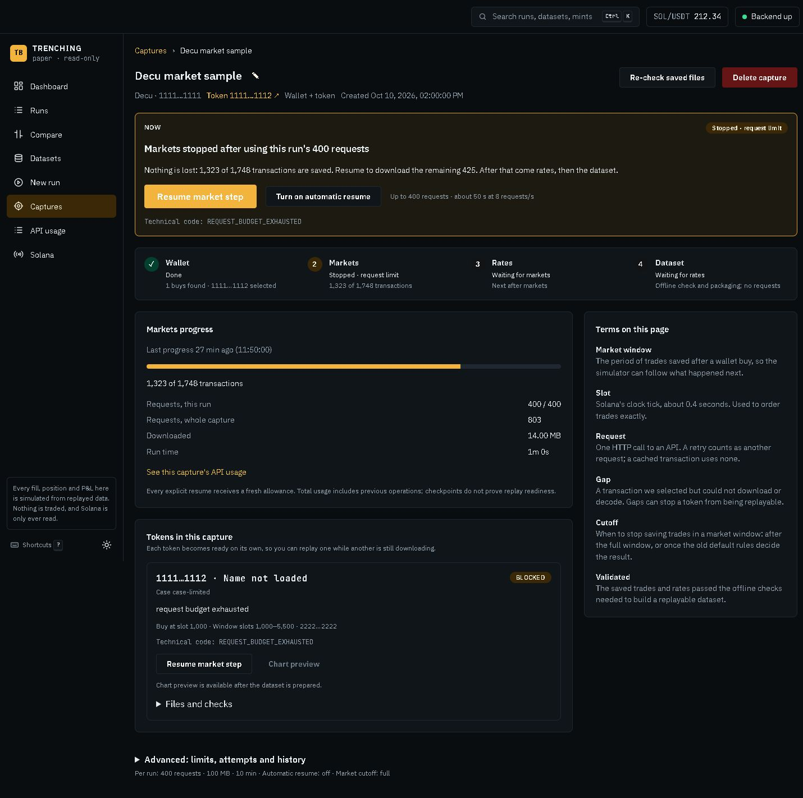
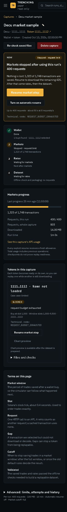

# Console design-gap delivery · 19 October 2026

Implemented the approved frontend brief across captures, setup, results and usage. Mantine, ECharts, React Query and the dark theme are retained. No new dependency, backend change or schema change.

## Verification

- `npm test`: **331 tests passed, 51 files passed**.
- `npm run lint`: passed, zero warnings.
- `npm run build`: passed.
- Browser: all six pages rendered at 1440 px and 375 px. No horizontal page overflow; wide tables scroll inside their containers. See [recorded dimensions](viewport-checks.json).
- Mock provider states checked: RPC not configured, rate limited, unavailable, not mainnet, local access required; plus empty activity, empty captures, unavailable preset, empty usage and empty chart range.
- Review fixes verified: rate-limit controls share one deadline; Markets never borrows Wallet progress; isolated trades remain visible; expanded charts stay inside their card.

Real-backend verification could not run: the frontend on port 5173 and backend on port 8081 were unreachable. No live provider calls were initiated.

The existing API does not include a token-case buy timestamp or a capture chart endpoint. Token facts therefore show the buy slot; Chart preview explains that a prepared dataset is required.

## Screenshots

| Page | 1440 px | 375 px |
|---|---|---|
| Captures | [Desktop](captures-1440.jpg) | [Phone](captures-375.jpg) |
| New capture | [Desktop](new-capture-1440.jpg) | [Phone](new-capture-375.jpg) |
| Capture detail | [Desktop](capture-detail-1440.jpg) | [Phone](capture-detail-375.jpg) |
| New run | [Desktop](new-run-1440.jpg) | [Phone](new-run-375.jpg) |
| Results chart | [Desktop](run-chart-1440.jpg) | [Phone](run-chart-375.jpg) |
| API usage | [Desktop](usage-1440.jpg) | [Phone](usage-375.jpg) |

Desktop capture detail:

Phone capture detail:

## Reproduce mock states

Start the frontend with `VITE_USE_MOCKS=true` supplied in the process environment, on port 5174. Use `/console/` routes. Add `?mockState=` with `captures-empty`, `activity-empty`, `preset-unavailable`, `usage-empty`, `chart-empty`, or a provider error code above to its relevant page. Capture detail also accepts every capture summary status, such as `STOPPED_LIMIT`, `RUNNING` and `WAITING_RETRY`. Reload after changing the query. The representative stopped capture is `/console/captures/capture-limited`.

## Files changed

- [frontend/src/charts/priceChart.test.ts](../../../frontend/src/charts/priceChart.test.ts) — Regression coverage: keeps isolated market observations visible across empty buckets.
- [frontend/src/charts/priceChart.ts](../../../frontend/src/charts/priceChart.ts) — Keeps isolated market observations visible across empty buckets.
- [frontend/src/components/DisplayValues.tsx](../../../frontend/src/components/DisplayValues.tsx) — Adds relative time with exact local timestamps.
- [frontend/src/components/MarketMarkerOverlay.tsx](../../../frontend/src/components/MarketMarkerOverlay.tsx) — Uses gold for simulated paper trade diamonds.
- [frontend/src/components/Recommendations.test.tsx](../../../frontend/src/components/Recommendations.test.tsx) — Regression coverage: separates settings from one-shot actions and shows applied state.
- [frontend/src/components/Recommendations.tsx](../../../frontend/src/components/Recommendations.tsx) — Separates settings from one-shot actions and shows applied state.
- [frontend/src/components/SourceLinks.test.tsx](../../../frontend/src/components/SourceLinks.test.tsx) — Regression coverage: omits missing capture crumbs and labels dataset/run links.
- [frontend/src/components/SourceLinks.tsx](../../../frontend/src/components/SourceLinks.tsx) — Omits missing capture crumbs and labels dataset/run links.
- [frontend/src/components/StateViews.test.tsx](../../../frontend/src/components/StateViews.test.tsx) — Regression coverage: explains provider errors and shares the original retry deadline.
- [frontend/src/components/StateViews.tsx](../../../frontend/src/components/StateViews.tsx) — Explains provider errors and shares the original retry deadline.
- [frontend/src/components/TradeChart.test.tsx](../../../frontend/src/components/TradeChart.test.tsx) — Regression coverage: adds empty-range recovery, data callbacks and correctly sized expanded plots.
- [frontend/src/components/TradeChart.tsx](../../../frontend/src/components/TradeChart.tsx) — Adds empty-range recovery, data callbacks and correctly sized expanded plots.
- [frontend/src/features/captures/CaptureCases.tsx](../../../frontend/src/features/captures/CaptureCases.tsx) — Presents token facts and actions while preserving technical controls.
- [frontend/src/features/captures/CaptureDetailPage.test.tsx](../../../frontend/src/features/captures/CaptureDetailPage.test.tsx) — Regression coverage: replaces duplicate layouts with Now, progress, terms and Advanced.
- [frontend/src/features/captures/CaptureDetailPage.tsx](../../../frontend/src/features/captures/CaptureDetailPage.tsx) — Replaces duplicate layouts with Now, progress, terms and Advanced.
- [frontend/src/features/captures/CaptureOverview.test.tsx](../../../frontend/src/features/captures/CaptureOverview.test.tsx) — Regression coverage: shows one stepper and stage-specific market progress.
- [frontend/src/features/captures/CaptureOverview.tsx](../../../frontend/src/features/captures/CaptureOverview.tsx) — Shows one stepper and stage-specific market progress.
- [frontend/src/features/captures/CaptureShared.tsx](../../../frontend/src/features/captures/CaptureShared.tsx) — Adds shared capture status chips.
- [frontend/src/features/captures/CapturesPage.test.tsx](../../../frontend/src/features/captures/CapturesPage.test.tsx) — Regression coverage: rebuilds list columns, filters, progress, paging and navigation.
- [frontend/src/features/captures/CapturesPage.tsx](../../../frontend/src/features/captures/CapturesPage.tsx) — Rebuilds list columns, filters, progress, paging and navigation.
- [frontend/src/features/captures/NewCapturePage.test.tsx](../../../frontend/src/features/captures/NewCapturePage.test.tsx) — Regression coverage: reworks wallet suggestions, exact activity values, naming and creation.
- [frontend/src/features/captures/NewCapturePage.tsx](../../../frontend/src/features/captures/NewCapturePage.tsx) — Reworks wallet suggestions, exact activity values, naming and creation.
- [frontend/src/features/captures/TokenVerdict.test.tsx](../../../frontend/src/features/captures/TokenVerdict.test.tsx) — Regression coverage: updates the existing test for the renamed saved-file action.
- [frontend/src/features/captures/activityDisplay.test.ts](../../../frontend/src/features/captures/activityDisplay.test.ts) — Regression coverage: formats lamports exactly and chooses ordered activity notes.
- [frontend/src/features/captures/activityDisplay.ts](../../../frontend/src/features/captures/activityDisplay.ts) — Formats lamports exactly and chooses ordered activity notes.
- [frontend/src/features/captures/captureNow.test.ts](../../../frontend/src/features/captures/captureNow.test.ts) — Regression coverage: defines clear copy for every capture status and stage.
- [frontend/src/features/captures/captureNow.ts](../../../frontend/src/features/captures/captureNow.ts) — Defines clear copy for every capture status and stage.
- [frontend/src/features/captures/useNextAction.test.ts](../../../frontend/src/features/captures/useNextAction.test.ts) — Regression coverage: adds next-step request and navigation hints.
- [frontend/src/features/captures/useNextAction.ts](../../../frontend/src/features/captures/useNextAction.ts) — Adds next-step request and navigation hints.
- [frontend/src/features/results/RunChartPage.test.tsx](../../../frontend/src/features/results/RunChartPage.test.tsx) — Regression coverage: adds context, token navigation, precise ranges and an event timeline.
- [frontend/src/features/results/RunChartPage.tsx](../../../frontend/src/features/results/RunChartPage.tsx) — Adds context, token navigation, precise ranges and an event timeline.
- [frontend/src/features/runs/NewRunPage.css](../../../frontend/src/features/runs/NewRunPage.css) — Shows agreed settings, limitations, field resets and explicit defaults fallback.
- [frontend/src/features/runs/NewRunPage.test.tsx](../../../frontend/src/features/runs/NewRunPage.test.tsx) — Regression coverage: shows agreed settings, limitations, field resets and explicit defaults fallback.
- [frontend/src/features/runs/NewRunPage.tsx](../../../frontend/src/features/runs/NewRunPage.tsx) — Shows agreed settings, limitations, field resets and explicit defaults fallback.
- [frontend/src/features/runs/configLabels.test.ts](../../../frontend/src/features/runs/configLabels.test.ts) — Regression coverage: formats agreed values and counts exact setting differences.
- [frontend/src/features/runs/configLabels.ts](../../../frontend/src/features/runs/configLabels.ts) — Formats agreed values and counts exact setting differences.
- [frontend/src/features/runs/runForm.test.ts](../../../frontend/src/features/runs/runForm.test.ts) — Regression coverage: trims decimal input scale without changing submitted values.
- [frontend/src/features/runs/runForm.ts](../../../frontend/src/features/runs/runForm.ts) — Trims decimal input scale without changing submitted values.
- [frontend/src/features/usage/ApiUsagePage.test.tsx](../../../frontend/src/features/usage/ApiUsagePage.test.tsx) — Regression coverage: groups providers, explains units, shows task shares and empty states.
- [frontend/src/features/usage/ApiUsagePage.tsx](../../../frontend/src/features/usage/ApiUsagePage.tsx) — Groups providers, explains units, shows task shares and empty states.
- [frontend/src/features/usage/usageData.test.ts](../../../frontend/src/features/usage/usageData.test.ts) — Regression coverage: groups usage, sorts tasks and fetches all capture choices.
- [frontend/src/features/usage/usageData.ts](../../../frontend/src/features/usage/usageData.ts) — Groups usage, sorts tasks and fetches all capture choices.
- [frontend/src/lib/codes.ts](../../../frontend/src/lib/codes.ts) — Centralizes plain labels, status tones and suggestion copy.
- [frontend/src/lib/format.test.ts](../../../frontend/src/lib/format.test.ts) — Regression coverage: adds deterministic relative-time formatting.
- [frontend/src/lib/format.ts](../../../frontend/src/lib/format.ts) — Adds deterministic relative-time formatting.
- [frontend/src/lib/glossary.ts](../../../frontend/src/lib/glossary.ts) — Uses plain explanations for capture terminology.
- [frontend/src/mocks/captureHandlers.ts](../../../frontend/src/mocks/captureHandlers.ts) — Adds stopped/legacy captures and selectable mock statuses.
- [frontend/src/mocks/fixtures.ts](../../../frontend/src/mocks/fixtures.ts) — Adds a six-minute chart fixture.
- [frontend/src/mocks/handlers.ts](../../../frontend/src/mocks/handlers.ts) — Serves meaningful chart windows and the empty-range mock.
- [frontend/src/mocks/previewState.ts](../../../frontend/src/mocks/previewState.ts) — Selects dev-only mock scenarios through mockState query parameters.
- [frontend/src/mocks/setupHandlers.ts](../../../frontend/src/mocks/setupHandlers.ts) — Adds varied activity, Binance usage and selectable error/empty states.
- [frontend/qa/20261019-design-gaps/capture-detail-1440.jpg](capture-detail-1440.jpg) — Browser verification evidence.
- [frontend/qa/20261019-design-gaps/capture-detail-375.jpg](capture-detail-375.jpg) — Browser verification evidence.
- [frontend/qa/20261019-design-gaps/captures-1440.jpg](captures-1440.jpg) — Browser verification evidence.
- [frontend/qa/20261019-design-gaps/captures-375.jpg](captures-375.jpg) — Browser verification evidence.
- [frontend/qa/20261019-design-gaps/captures-empty-375.jpg](captures-empty-375.jpg) — Browser verification evidence.
- [frontend/qa/20261019-design-gaps/chart-empty-375.jpg](chart-empty-375.jpg) — Browser verification evidence.
- [frontend/qa/20261019-design-gaps/new-capture-1440.jpg](new-capture-1440.jpg) — Browser verification evidence.
- [frontend/qa/20261019-design-gaps/new-capture-375.jpg](new-capture-375.jpg) — Browser verification evidence.
- [frontend/qa/20261019-design-gaps/new-run-1440.jpg](new-run-1440.jpg) — Browser verification evidence.
- [frontend/qa/20261019-design-gaps/new-run-375.jpg](new-run-375.jpg) — Browser verification evidence.
- [frontend/qa/20261019-design-gaps/preset-unavailable-375.jpg](preset-unavailable-375.jpg) — Browser verification evidence.
- [frontend/qa/20261019-design-gaps/run-chart-1440.jpg](run-chart-1440.jpg) — Browser verification evidence.
- [frontend/qa/20261019-design-gaps/run-chart-375.jpg](run-chart-375.jpg) — Browser verification evidence.
- [frontend/qa/20261019-design-gaps/usage-1440.jpg](usage-1440.jpg) — Browser verification evidence.
- [frontend/qa/20261019-design-gaps/usage-375.jpg](usage-375.jpg) — Browser verification evidence.
- [frontend/qa/20261019-design-gaps/usage-empty-375.jpg](usage-empty-375.jpg) — Browser verification evidence.
- [frontend/qa/20261019-design-gaps/viewport-checks.json](viewport-checks.json) — Browser verification evidence.
- [frontend/qa/20261019-design-gaps/verification.md](verification.md) — Delivery report, complete changed-file list and screenshot index.
